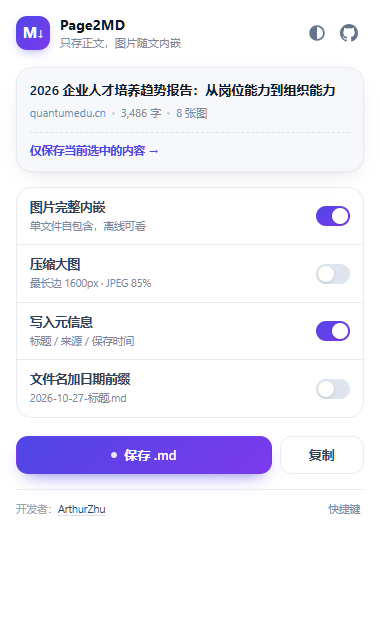
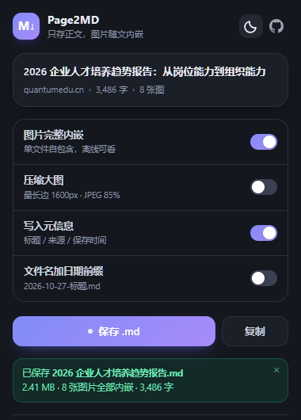

# Page2MD · 网页转 Markdown（图片完整内嵌）

把网页正文提取成 **一个自包含的 `.md` 文件**：导航、广告、推荐位、评论区、分享条全部去掉，正文里的图片以 **Base64 dataURI 直接写进 Markdown**，不依赖任何外部路径或图床。

> 目标场景：把公众号/新闻/博客文章长期归档到 Obsidian、Typora、思源笔记里，几年后打开仍然有图。

| 浅色 | 深色 |
| --- | --- |
|  |  |

## 功能

- **正文识别**：Mozilla Readability 为主 + 块密度算法兜底，只保留文章主体
- **噪声清除**：导航、广告位、分享条、相关阅读/猜你喜欢、热门推荐、评论、面包屑、页脚、追踪像素
- **图片完整内嵌**：逐张抓取字节 → `data:image/png;base64,...`，同一图片自动去重
- **清晰度择优**：`srcset` 取最大候选、`<picture>` 取最优源、懒加载 `data-src` 回退、优先使用页面实际渲染的那张
- **Markdown 质量**：GFM 表格 / 删除线 / 任务列表、代码块语言标注、引用、图注斜体、KaTeX 还原
- **元信息**：YAML front matter（标题 / 来源 URL / 作者 / 发布时间 / 站点 / 保存时间 / 字数 / 图片数）
- **两种入口**：整页保存、仅保存选中内容
- **三种触发**：点扩展图标（弹窗）、右键菜单、快捷键 `Alt+Shift+M` / `Alt+Shift+S`
- **进度可见**：弹窗内进度条 + 页面右下角浮层（右键/快捷键触发时）
- **深色模式**：默认跟随系统，也可在弹窗右上角一键切换（跟随系统 / 浅色 / 深色）

## 安装

1. `npm install && npm run build`（或直接用已构建好的 `dist/`）
2. 打开 `chrome://extensions` → 打开右上角「开发者模式」
3. 点「加载已解压的扩展程序」→ 选择本项目的 **`dist`** 目录
4. 建议把扩展固定到工具栏

> 需要 Chrome / Edge 109+。想保存本地 `file://` 页面时，需在扩展详情页打开「允许访问文件网址」。

## 使用

- **整页保存**：点工具栏图标 → 「保存 .md」
- **只保存选区**：选中正文 → 点图标 →「仅保存当前选中的内容」，或直接按 `Alt+Shift+S`
- **右键菜单**：页面空白处右键 / 选中文字后右键
- **复制**：弹窗里的「复制」把 Markdown 文本放进剪贴板（不下载文件）

保存的文件落在浏览器默认下载目录，文件名取自文章标题（可在设置里加日期前缀）。若希望每次选择保存位置，在 Chrome 设置里打开「下载前询问每个文件的保存位置」。

### 设置项

| 选项 | 说明 |
| --- | --- |
| 图片完整内嵌 | 默认开启。关闭后图片保留原始 URL |
| 压缩大图 | 默认关闭。开启后最长边 1600px、JPEG 85%，显著减小文件体积 |
| 写入元信息 | 默认开启。生成 YAML front matter |
| 文件名加日期前缀 | 默认关闭。`2026-10-27-标题.md` |

## 实现要点

```
点图标/快捷键/右键
   └── background (service worker)
         ├── 按需注入 content.js（scripting.executeScript）
         ├── 接收 FETCH_IMAGE：带 host 权限跨域抓字节（不受页面 CORS 限制）
         └── 进度/结果回传
   └── content script
         ├── Readability 提取 → 清洗 → 解析图片地址 → Turndown 转 Markdown
         ├── 图片占位符 → 并发抓取 → 回填 dataURI
         └── 生成 Blob → <a download> 落盘
```

- **为什么抓图放在 service worker**：内容脚本里的 `fetch` 受页面 CORS 约束；SW 有 `host_permissions`，才能稳定拿到图片字节。
- **为什么要「打标」**：离线解析出的 DOM 里 `img.currentSrc`、`naturalWidth` 都是空的。提取前把活 DOM 上真正渲染的地址/尺寸写到副本的 `data-w2m-*` 上，才能正确识别懒加载占位图、追踪像素和响应式图片。
- **失败兜底**：单张图失败不影响整体，保留原始链接；同源图片再用页面上下文取一次；网络抖动自动重试一次；4xx 不重试。
- **体积**：Base64 会让图片体积增加约 33%，这是「单文件自包含」的代价。图片多时建议开启「压缩大图」。

## 已知限制

- 需要登录/付费墙/验证码的页面（如公众号触发"环境异常"）拿不到正文
- 纯前端渲染（等到内容靠 JS 二次加载）的页面，可能在内容出现前就完成提取
- 极少数站点有图片防盗链且校验 `Referer`，这类图会保留原链接
- 超复杂表格（`rowspan`/`colspan`）转 GFM 会失真
- 可达几十 MB 的 Markdown 需要支持 `data:` 图片的查看器（Typora / Obsidian / VS Code 预览均可）

## 开发

```bash
npm install
npm run build      # 构建到 dist/
npm run dev        # watch 模式
npm run typecheck  # tsc --noEmit
npm test           # 单元测试（jsdom）
npm run e2e        # 真实浏览器端到端（自动构建，加载扩展，跑完整链路）
npm run pack       # 打包 dist/ 为 release/page2md-<version>.zip
```

端到端测试会用 Playwright 启动 Chromium（`channel: 'chromium'`），若本机没有 Playwright 的 Chromium，会自动回退到已安装的 Edge（`msedge`）。

```
src/
  background.ts         service worker：菜单/快捷键、图片抓取、脚本注入
  content/
    index.ts            提取编排 + 消息协议 + 下载
    images.ts           图片收集、并发抓取、dataURI 回填
    toast.ts            页面内浮层
  lib/
    extract.ts          Readability + 兜底 + 页面元信息
    clean.ts            噪声清除、标题归一
    markdown.ts         Turndown 规则与后处理
    urls.ts             图片地址择优（srcset/懒加载/打标）
    text.ts             字数、文件名、front matter
    types.ts            共享类型
  popup/                弹窗 UI 逻辑
tests/
  pipeline.test.ts      提取/清洗/转换单元测试
  e2e.mjs               真实浏览器端到端
  smoke.mjs             线上文章冒烟测试
```
